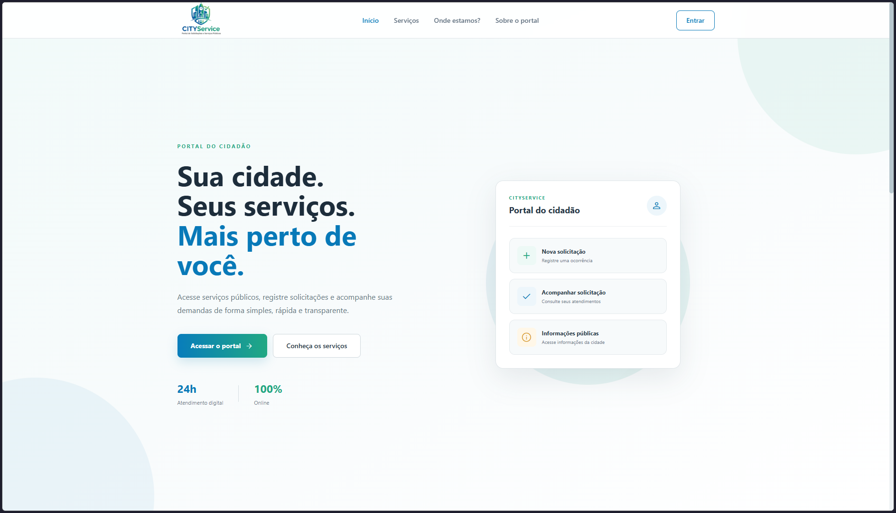
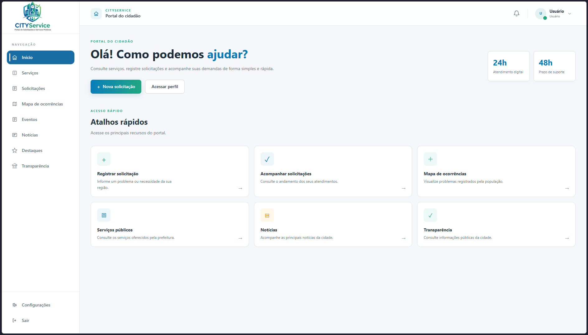

# CityService

### Conectando cidadãos à cidade.

Um portal web desenvolvido para aproximar os cidadãos dos serviços e informações municipais.

 

 
 

---

## Sobre o projeto

O **CityService** é um portal web criado conforme as orientações do professor Rafael Moura, com o objetivo de desenvolver uma plataforma que conecte o cidadão à cidade.

O projeto busca centralizar informações e facilitar o acesso dos cidadãos aos serviços disponibilizados pela plataforma.

🔗 **Acesse o projeto publicado:** [https://jcf00.github.io/CityService/CityService/](https://jcf00.github.io/CityService/CityService/)

---

## Capturas de tela

### Página inicial

 

### Funcionalidades do sistema

---

## Funcionalidades

- Fazer solicitações à Prefeitura.
- Verificar notícias da cidade.
- Analisar um mapa de ocorrências da cidade.

---

## Tecnologias e recursos

---

## Acessos do sistema

| Login | Senha |
|:---:|:---:|
| administrador | Admin123! |
| usuario | Usuario123! |
| atendente | Atendente123! |

---

## Documentação

A documentação completa do projeto está disponível para download em formato `.docx`.

 

 
 

---

## Equipe de desenvolvimento

| Integrantes |
|:---:|
| Joel Costa de França |
| Giovanni Galanjauskas Kacevicius Lima Ferreira |
| Vinicius Iglesias Gaspar|
| Murilo Caires de Araújo |
| Gabriel Souza Santana |
| Henrique Rodrigues Silva |

## Orientação

**Professor orientador**

Rafael Moura

---

**CityService**

*Desenvolvido com dedicação pela equipe CityService.*

 

